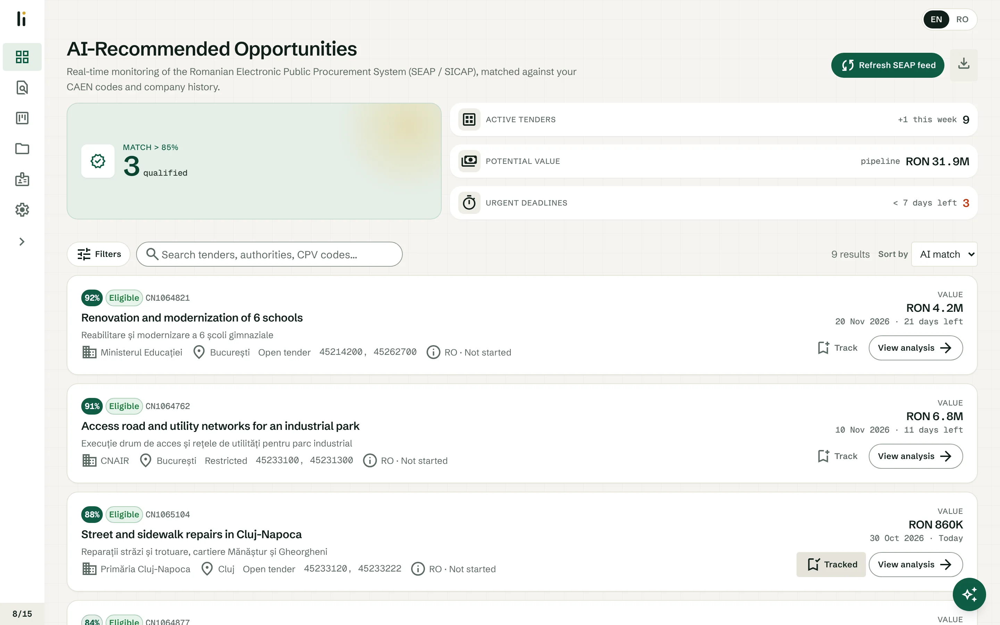
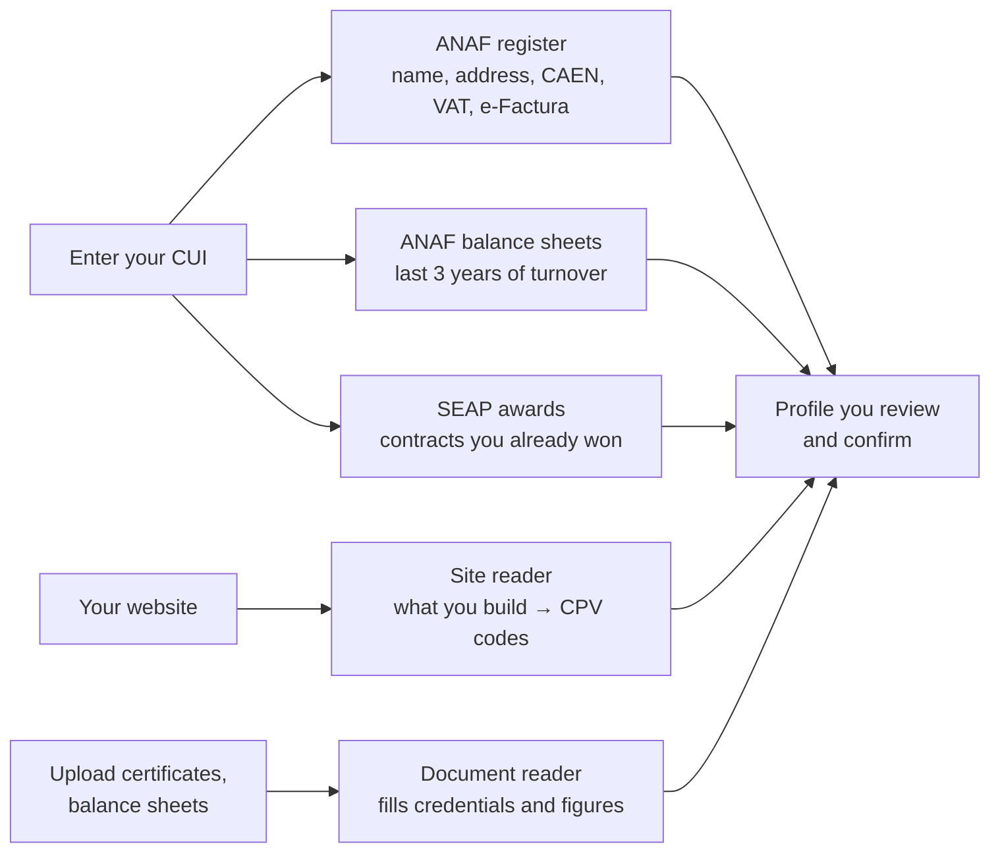

<div align="center">

# Licits

**Public tenders, read for you.**

Licits watches Romania's public procurement system (SEAP / SICAP), tells small and mid-sized contractors which open tenders they can really win, and prepares the paperwork.

[licits.com](https://licits.com) · English and Romanian · invite-only beta

</div>

<p align="center">
  
</p>

---

## The problem

Every day hundreds of public tenders are published in Romania. For a small contractor the work is not winning them, it is **finding the few that fit, working out whether the company is even allowed to bid, and then assembling a pile of documents** (offer, DUAE, certificates, references) before a hard deadline. Most firms do this by hand, in Romanian, from a portal that was not built for searching.

Licits does the reading and the first draft. **The company always makes the decision**: Licits shows its reasoning, flags what is unclear and never submits anything for you.

## What it does

| | |
|---|---|
| **Finds** | Pulls every open tender from SEAP several times a day and ranks them against your company's work, region and size. |
| **Explains** | A plain-language English or Romanian title and summary for each notice, with the reference codes kept intact. |
| **Checks** | Reads the tender's requirements and compares them with your turnover, experience and certificates, one requirement at a time: met, not met, or unclear. |
| **Prepares** | Drafts the technical offer and the DUAE (the European single procurement document) from your profile and the tender. |
| **Tracks** | A pipeline board for the tenders you follow, from review to applied. |
| **Researches** | Shows who the buyer awarded similar contracts to, and how their finances look. |

## From sign-up to a working profile in minutes

Most tools make you type your company in. Licits **reads it from official sources** and asks you to confirm.



The onboarding has seven short steps, and each can be completed from what Licits already found:

1. **Company.** Type the CUI and press *Fill from ANAF*. Licits fetches the legal name, registered address, county, main CAEN code, VAT and e-Factura status, and the net turnover for the last three filed years. It also looks up the contracts SEAP shows as awarded to that CUI and adds them as your reference contracts. Add your website and an agent reads your services and projects pages to pick the matching work.
2. **Your works.** Trades and work types (CPV codes). Pre-selected from your website; solar, electrical, roads, buildings, water, HVAC and more are covered, with the certificates each trade usually needs.
3. **Where and how.** Counties you can work in (pick from the list or click the map), whether you bid alone, in a consortium or as a subcontractor, your largest contract and how many projects you can run at once.
4. **Turnover.** Pre-filled from ANAF; you can correct it or upload a balance sheet and let the document reader take the figure.
5. **Authorizations.** ISO, ANRE, ISCIR and other certificates. Upload the file and the document reader fills in the type, number and validity dates.
6. **SEAP and team.** SEAP registration, e-signature, staff by role, bank guarantee capacity and insurance.
7. **Review and confirm.**

Progress is saved after every step. The same profile powers matching, eligibility checks and the generated drafts, and you can edit all of it later on the Profile page, including downloading the documents you stored.

> **What is a CAEN code, and what is CPV?** CAEN is the company's registered activity code (what it is *allowed* to do). CPV is the tender's code for *what is being bought*. To bid, the work in the CPV has to fit your CAEN codes.

## Inside the app

**Opportunities.** The feed of open tenders, scored against your profile, with filters for work type (CPV), county, value and deadline. Titles and summaries are in your language.

**Tender analysis.** One page per tender: a summary, the procedure timeline (published, clarification deadline, submission deadline), the executive data sheet, your match score and the reasons behind it, and the eligibility analysis. Until the tender documents are read, the page says so instead of guessing.

**Eligibility analysis.** Turnover and experience are compared with plain arithmetic, not left to a language model. The model only reasons about what needs judgment (free-text certificate requirements) and always writes *why*, never a bare verdict. Where the data does not say, the answer is "unclear, check this".

**Document preparation.** Reads the tender file (scanned PDFs included) and assembles a first draft of the offer and the DUAE from your profile and company archive. You review, edit, ask the assistant to revise a passage, and export. Nothing is submitted for you.

**Past winners.** One button on a tender shows who the same buyer awarded its last five contracts of this kind to, how much it awarded overall, and each winner's latest turnover, profit and headcount from ANAF. It runs on a monthly quota; opening the same tender again is free.

**Renewal detection.** When a buyer re-tenders the same kind of work on a rhythm, Licits flags it and estimates when the next notice is due. On the top plan it also shows the price range of the buyer's past awards for comparable work, as a percentage of its own estimate. This is descriptive history, not a bidding recommendation.

**Pipeline.** A kanban board for the tenders you follow: new, reviewing, applied, rejected.

**Archive.** A document vault for your certificates and references, with signed downloads.

**Assistant.** A chat bubble inside the app that knows which screen you are on and helps with the tender, your profile and the drafts.

**Live map.** The landing page shows the newest open construction notice for each county seat on a dotted map of Romania, linked to the official notice.

## Plans

Prices are in RON per month, excluding VAT. New users get the first two weeks free.

| | **Start** · 199 | **Growth** · 349 | **Pro** · 499 |
|---|:---:|:---:|:---:|
| SEAP feed with plain titles and summaries | ✓ | ✓ | ✓ |
| All filters | ✓ | ✓ | ✓ |
| Eligibility checks per month | 30 | 100 | unlimited |
| Scanned PDF reading | unlimited | unlimited | unlimited |
| Offer and DUAE drafts per month | 2 | 10 | unlimited |
| Past-winner lookups per month | 5 | 25 | 100 |
| Document vault with downloads | ✓ | ✓ | ✓ |
| Renewal detection | | ✓ | ✓ |
| E-mail alerts for renewing buyers | | ✓ *(coming soon)* | ✓ *(coming soon)* |
| Past price range on renewing work | | | ✓ |
| Users | 1 | 3 | 5 |

Growth is the plan most small contractors need. Each line carries a **?** with a plain-language explanation on the pricing page.

## Principles

- **Justify, never silently decide.** Every score, verdict and summary comes with its reason. A low score is a signal, not a hidden filter, and unclear stays "unclear".
- **Official sources first.** Company data comes from ANAF and SEAP, public registers, so you confirm instead of typing.
- **Numbers by arithmetic, judgment by model.** Comparisons that have a right answer are computed. The model handles wording and the genuinely ambiguous.
- **You stay in control.** Licits prepares drafts. It never submits an offer, and it states plainly what it could not verify.
- **Built to cross borders.** Every tender carries a country and source; each source is one adapter. Romania is first, and nothing in scoring, AI or eligibility is Romania-specific.

## Under the hood

| Layer | Technology |
|---|---|
| Frontend | Next.js (App Router), TypeScript, Tailwind, `next-intl` (EN/RO), TanStack Query, zustand |
| Backend | FastAPI (Python), SQLModel, one serverless function behind the same origin at `/api` |
| Data | Supabase: Postgres, Auth (invite-only), Row Level Security, Storage for documents |
| AI | Meta AI Responses API for summaries, titles, requirement extraction, eligibility reasoning and page transcription |
| Sources | SEAP / SICAP tenders and awards, ANAF VAT register and balance sheets (public web services) |
| Hosting | Vercel; a GitHub Actions job syncs SEAP every six hours |

Access is **invite-only** during the beta: public sign-ups are off, and accounts are created through a server action that registers the invited e-mail on a short-lived allowlist the database checks before it creates the user. Company data is protected by row-level security so one company can never read another's.

## Status

Live and in invite-only beta. Honest list of what is not finished:

- **E-mail alerts** for renewing buyers are shown as *coming soon* and not built yet.
- **Billing** is not built. Until it is, every account sees the top plan; only the past-winner quota is enforced today, the other plan limits are not.
- **Renewal and price-range wording** should get a lawyer's review before wide release.

## Run it locally

Setup, environment variables, the API reference and deploy notes are in the **[development guide](docs/DEVELOPMENT.md)**; the API contract is [`backend/openapi.json`](backend/openapi.json) and the change history is in [`API_CHANGES.md`](API_CHANGES.md).

```bash
npm install
npm run dev          # web on :3000
uvicorn backend.main:app --reload   # API on :8000
```

## Repository layout

```
app/          Next.js pages (locale-prefixed): landing, onboarding, app, auth, legal
components/   UI, including landing/, onboarding/, assistant/, agent/
lib/          API client, onboarding and company data, ANAF and site-scan actions
backend/      FastAPI: SEAP adapter, scoring, eligibility, AI client, winners, renewal
supabase/     SQL migrations (schema, row-level security, invite allowlist)
messages/     UI strings, en.json and ro.json
docs/         development guide
```

---

<sub>Licits is a decision-support tool. Scores, summaries and drafts are aids; the company is responsible for checking them against the official tender documents before bidding.</sub>
