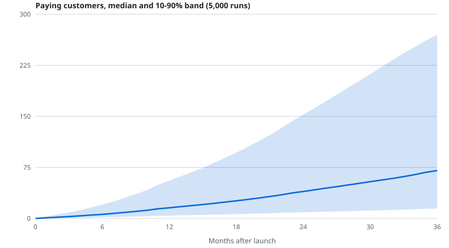

# Adoption model: how many firms could pay for Licits?

A Bass diffusion model whose market is **measured from a year of SEAP construction awards**, run 5,000 times with its behavioural inputs drawn from stated ranges. The output is a band, not a number. Code: [`backend/scripts/adoption_model.py`](../backend/scripts/adoption_model.py), data collection: [`collect_seap_market.py`](../backend/scripts/collect_seap_market.py), tests: [`test_adoption_model.py`](../backend/tests/test_adoption_model.py).



## Result

Scope: construction works (CPV division 45), Romania, plans at the list prices (199 / 349 / 499 RON a month, excluding VAT). Launch in December 2026.

| After launch | Paying customers (10% / **median** / 90%) | Annual recurring revenue, RON |
|---|---|---|
| 6 months | 2 / **6** / 20 | 6k / **22k** / 76k |
| 12 months | 4 / **16** / 56 | 15k / **57k** / 203k |
| 24 months | 9 / **40** / 152 | 33k / **146k** / 560k |
| 36 months | 15 / **70** / 270 | 52k / **256k** / 994k |

- The firms that could ever pay (market size) come out at **181 / 420 / 798** (10% / median / 90%).
- The chance of 100 or more paying customers is about 2% after 12 months and 20% after 24 months.
- Read plainly: in construction alone this is a small business with a wide range of outcomes. Licits also covers CPV divisions 30, 33, 50, 72 and 60, which are not in this model, so it understates the total.

## What is measured, and what is assumed

**Measured from SEAP** (6 Nov 2025 to 31 Oct 2026, 2,686 construction awards; winners parsed from 517 randomly sampled award notices)

| Input | Value | How it is used |
|---|---|---|
| Awards per year | about 2,720 | starting point for the market |
| Distinct winners | 396 in the 517-award sample; 75 won more than once | repeat winners mean firms grow slower than awards |
| Heaps' law exponent for distinct winners | 0.80 (5-95%: 0.79 to 0.81) | extrapolates distinct winners from the sample to the full year |
| Offers per award | 3.55 on average; 29% have one bidder | caps how many bidding firms exist per winner |
| Award value | median 20.0M RON; 34% under 5M; 13% under 1M | share of firms of "small and mid-sized" scale |
| Awards by calendar month | 125 (Feb) to 474 (Oct) | seasonality of demand, shrunk half-way to flat |

**Assumed** (priors, not measurements; ranges below are what the 5,000 runs draw from)

| Input | Range | Reason |
|---|---|---|
| Bidding firms per winner | 1.5 to 3.5, never above offers per award | losers also bid; many repeat |
| "Small and mid-sized" ceiling | 10M to 50M RON, log-uniform | README target customer |
| Share who would ever pay for such a tool | Beta(3, 7), mean 30% | **no data; biggest soft spot** |
| Innovation rate *p* | 0.004 to 0.03 | published B2B mean is about 0.03; invite-only starts lower |
| Imitation rate *q* | 0.2 to 0.5 | published mean about 0.38 (Sultan, Farley, Lehmann 1990; check before citing) |
| Trial to paid | Beta(5, 15), mean 25% | two free weeks, then a card |
| Monthly churn | 2% to 6% | small-business software |
| Plan mix | Dirichlet(4, 5, 1) over Start / Growth / Pro | README: Growth is the plan most firms need |
| Invite-only | 15 to 40 new accounts a month, growing 5% to 25%, lifted in month 9 to 15 | the beta |

## How it works

Each month, firms that are not paying customers start a trial at rate (p × season + q × paying / market) × (market − paying). Trials convert at the trial-to-paid rate; the rest, and anyone who later churns, return to the pool. Word of mouth comes only from paying customers. Invites cap monthly trials until the beta opens. Revenue is paying customers times the mix-weighted plan price.

Two choices worth knowing: a plain Bass model never lets anyone leave, which made customers *fall* once the market saturated, so churners and non-converters return to the pool here. And the invite cap almost never binds: demand is lower than the invite budget, so the beta is not what limits growth.

## What drives the answer

Rank correlation of each input with paying customers at month 24:

| Input | Correlation |
|---|---|
| Trial to paid | +0.63 |
| Market size | +0.50 |
| Innovation rate *p* | +0.46 |
| Share who would ever pay | +0.45 |
| Imitation rate *q* | +0.22 |
| Monthly churn | -0.13 |

Two of the four biggest levers are assumptions, not data (conversion and the share who would pay). The honest message is that **real beta data will narrow this band more than any further modelling**: trial-to-paid and churn can be measured within weeks of the invite-only cohorts.

## Limits

- Winners are a floor on the bidding population; the number of bidding firms is inferred, not observed.
- Distinct winners are extrapolated from 517 awards to about 2,720 with Heaps' law, a roughly five-fold step.
- One observation per calendar month makes the seasonal index rough (October is a spike of 474 awards).
- Scope is construction and Romania only; no price changes, competitors or feature releases.
- This is a planning range for a hackathon, not a sales forecast.

## Reproduce

```bash
backend/.venv/Scripts/python backend/scripts/collect_seap_market.py 12 600   # pulls SEAP, about 10 minutes
backend/.venv/Scripts/python backend/scripts/adoption_model.py               # writes docs/validation/adoption_*
```

The collector writes to `backend/data/raw/` (git-ignored, tender dumps are not committed). The committed `adoption_inputs.json` and `adoption_results.json` hold only the aggregates above. `numpy` is in `requirements-dev.txt` only, to keep the Vercel bundle small.
